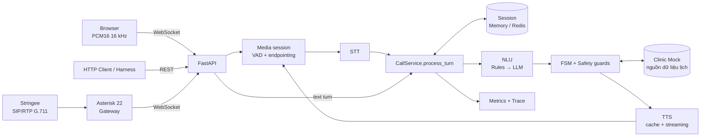

# BÁO CÁO KỸ THUẬT CALLBOT Y TẾ

| Thuộc tính | Nội dung |
| --- | --- |
| Phiên bản | 2.0 |
| Ngày cập nhật | 13/10/2026 |
| Mục đích | Báo cáo kỹ thuật gửi mentor trước buổi demo |
| Ngôn ngữ hệ thống | Tiếng Việt (`vi-VN`) |
| Dữ liệu sử dụng | Dữ liệu bệnh nhân giả lập (synthetic) |
| Căn cứ | Hợp đồng AIHR-PC-001 Rev 1.0; đặc tả [`AGENTS.md`](../../AGENTS.md) |

## Tóm tắt

Báo cáo mô tả callbot tiếng Việt cho phòng khám, thực hiện bảy kịch bản của hợp đồng: xác minh danh
tính, xác nhận, hủy, đổi lịch, chuyển nhân viên, không liên lạc được và đặt lịch inbound. Hệ thống
nhận cuộc gọi qua ba kênh (HTTP, trình duyệt, điện thoại) và xử lý tất cả bằng **một lõi hội thoại
duy nhất** (`process_turn`).

Thiết kế dựa trên ba nguyên tắc:

1. **Mô hình đề xuất, quy tắc quyết định.** STT, rules và LLM chỉ tạo ra cách hiểu câu nói. Mọi hành
   động ghi lịch đều đi qua máy trạng thái (FSM) và các safety guard viết cố định trong code.
2. **Suy giảm có kiểm soát thay vì treo.** Mỗi lượt có ngân sách thời gian. Mỗi thành phần AI có
   phương án dự phòng. Khi dự phòng cũng thất bại, bot chuyển nhân viên trước hạn 8 giây.
3. **Một nguồn dữ liệu duy nhất.** Trạng thái lịch hẹn chỉ nằm ở Clinic Mock. Session chỉ giữ trạng
   thái hội thoại.

| Hạng mục | Trạng thái |
| --- | --- |
| Đã hoàn thành | Lõi hội thoại cho 3 kênh; 7 kịch bản; 5 safety guard SF-01…05; barge-in trên browser và phone; fallback cho VAD/STT/NLU/TTS; metrics và trace theo từng lượt; bộ benchmark v1.0 |
| Kết quả kiểm thử | Phần 7 (đang chờ bổ sung số liệu) |
| Chưa hoàn thành trước go-live | Đóng Security P0; VM Asterisk production kèm health check và alert; đo latency trên server đã deploy; diễn tập rollback (§8.2) |
| Rủi ro kỹ thuật chính | Latency STT vượt ngân sách; LLM p50 vượt ngân sách; đánh giá STT chưa dùng giọng thật (§8.4) |

---

## 1. Giới thiệu

### 1.1. Bài toán

Phòng khám cần gọi điện cho bệnh nhân để xác nhận, hủy hoặc đổi lịch khám, và nhận cuộc gọi đặt lịch
mới. Callbot phải nói chuyện tự nhiên bằng tiếng Việt, cho phép người gọi ngắt lời. Đồng thời, nó
**không bao giờ** được tiết lộ thông tin lịch khám trước khi xác minh danh tính, ghi sai lịch hoặc
đưa ra tư vấn y khoa.

### 1.2. Kênh giao tiếp

| Kênh | Mục đích | Được chấm điểm |
| --- | --- | --- |
| HTTP API (`POST /v1/calls`, `/turn`) | Tích hợp và chạy scoring harness | Có, toàn bộ metric §5 của hợp đồng |
| Browser WebSocket | Hội thoại giọng nói realtime | Không, dùng để chứng minh thiết kế streaming |
| Điện thoại (Stringee → SIP/RTP → Asterisk → WebSocket) | Cuộc gọi thật | Gate pass/fail tuần 6 |

### 1.3. Mục tiêu đo được

| Mục tiêu | Ngưỡng | Nguồn |
| --- | --- | --- |
| Tỷ lệ hoàn thành kịch bản | ≥ 95 % trên ≥ 100 case | Go-live gate 1 |
| Severe failure (SF-01…05) | 0 lỗi qua 3 lần chạy liên tiếp với LLM thật | Go-live gate 2 |
| Thời gian xử lý mỗi endpoint | < 8 s (p100) | Hợp đồng §4.1 |
| `/turn` p95 | ≤ 2 s | Go-live gate 3 |
| Lượt không cần gọi LLM | ≥ 70 % | AGENTS §7 |
| Câu bot lấy từ TTS cache | ≥ 80 % | AGENTS §7 |

### 1.4. Phạm vi

**Trong phạm vi:** HTTP API, browser voice, phone SIP, VAD, STT, NLU (rules và LLM), FSM, safety
guards, TTS, tích hợp Clinic Mock, session, metrics và trace.

**Ngoài phạm vi:** chẩn đoán, diễn giải triệu chứng, tư vấn thuốc (luôn chuyển nhân viên); thanh
toán, bảo hiểm, giới thiệu chuyên khoa, kê đơn; dữ liệu bệnh nhân thật; chuyển máy trực tiếp trên
SIP; chạy nhiều instance.

### 1.5. Thuật ngữ

| Thuật ngữ | Nghĩa |
| --- | --- |
| Lượt (turn) | Một câu của người gọi và một câu trả lời của bot |
| Endpointing | Xác định thời điểm người gọi nói xong |
| Barge-in | Người gọi nói chen khi bot đang phát âm thanh |
| Read-back | Bot đọc lại ngày, giờ, cơ sở khám trước khi xin xác nhận |
| Fast-path | Câu được rules hiểu chắc chắn, không cần gọi LLM |
| TTFA | Time to first audio, thời gian tới byte âm thanh đầu tiên |
| SF | Severe failure, lỗi nghiêm trọng theo hợp đồng |

---

## 2. Yêu cầu

### 2.1. Yêu cầu chức năng

| ID | Yêu cầu | Căn cứ |
| --- | --- | --- |
| FR-01 | Xác minh họ tên và ngày sinh bằng câu hỏi mở trước khi đọc bất kỳ thông tin lịch nào | Hợp đồng §1.1.1–1.1.2 |
| FR-02 | Chỉ xác nhận lịch sau khi đã đọc lại **đầy đủ** ngày, giờ và cơ sở và người gọi đồng ý | §1.1.3, TT-4 |
| FR-03 | Hủy lịch cần xác nhận lần hai và lý do hủy thuộc danh sách cho phép | §1.1.4 |
| FR-04 | Đổi/đặt lịch chỉ bằng slot do `GET /slots` trả về trong chính cuộc gọi | §1.1.6, §1.1.10 |
| FR-05 | Chuyển nhân viên khi ngoài kịch bản, câu hỏi lâm sàng, người gọi yêu cầu hoặc hệ thống lỗi | §1.1.5, §1.2.1 |
| FR-06 | Ba lượt im lặng liên tiếp kết thúc với `UNREACHABLE`, tăng `attempt_count` | §1.1.7, TT-2 |
| FR-07 | Hai lượt không hiểu liên tiếp chuyển nhân viên với `NOT_UNDERSTOOD`; barge-in không tính là không hiểu | TT-5 |
| FR-08 | Browser hỗ trợ streaming audio hai chiều, transcript, barge-in và kết nối lại | FE-1…5 |
| FR-09 | Lưu outcome, trace và mốc thời gian của từng lượt | GW-4 |

### 2.2. Yêu cầu phi chức năng

| ID | Yêu cầu | Cách kiểm chứng |
| --- | --- | --- |
| NFR-01 | Mọi HTTP endpoint trả về trong 8 s | p100 trên bộ kiểm thử |
| NFR-02 | `/turn` p95 ≤ 2 s | Đo trên server đã deploy |
| NFR-03 | Mỗi `call_id` chỉ xử lý một lượt tại một thời điểm | Test concurrency (PL-1) |
| NFR-04 | Lệnh ghi lịch idempotent, không ghi trùng khi retry | Test idempotency-key (PL-3) |
| NFR-05 | Lỗi STT/LLM/TTS được xử lý bằng fallback, không làm treo cuộc gọi | Test lỗi upstream (PL-5) |
| NFR-06 | Audio browser dùng frame 20 ms; bỏ frame thay vì xếp hàng vô hạn | Giới hạn kích thước và tốc độ frame (GW-2, GW-3) |
| NFR-07 | Chỉ dùng dữ liệu synthetic | Cấu hình môi trường |

### 2.3. Quy tắc an toàn

| Mã | Quy tắc | Cơ chế thực thi |
| --- | --- | --- |
| SF-01 | Chỉ sửa appointment thuộc cuộc gọi hiện tại | `appointment_guard` ràng buộc appointment và patient của cuộc gọi |
| SF-02 | Chỉ dùng slot đã cung cấp trong cuộc gọi | `slot_guard` chỉ chấp nhận slot đã liệt kê trong session |
| SF-03 | Không đọc thông tin định danh để người gọi đồng ý | `identity_guard`; bot chỉ hỏi mở và tự so khớp |
| SF-04 | Không tư vấn lâm sàng | `clinical_guard` nhận diện câu hỏi y khoa, chuyển `CLINICAL_QUESTION` |
| SF-05 | Hủy lịch phải có xác nhận lần hai | Bộ đếm xác nhận hủy = 2 trước khi gửi lệnh hủy |

**Quy tắc bổ sung (TT-4):** nếu phần read-back bị người gọi ngắt trước khi đọc xong, câu "vâng" tiếp
theo **không** được dùng để xác nhận; bot phải đọc lại đầy đủ.

### 2.4. Ngân sách latency người dùng cảm nhận

Khoảng thời gian từ lúc người gọi nói xong đến khi nghe thấy âm thanh đầu tiên của bot:

| Giai đoạn | Mục tiêu p50 / p95 | Ghi chú |
| --- | --- | --- |
| Endpointing | 700 ms; tối đa 1.600 ms | Chờ 700 ms im lặng; tự giãn ×2,2 nếu người gọi hay ngập ngừng |
| STT | 500 / 700 ms | **Google `latest_long` thực tế 1,3–3,0 s mỗi lượt, vượt ngân sách** |
| NLU | 0 ms (rules) / ≤ 900 ms (LLM) | `gpt-4.1-mini` p50 0,96 s, **vượt ngân sách**, nên phải tối đa hóa fast-path |
| Clinic Mock | ≤ 100 / 250 ms | Cùng region, pooled HTTP client |
| TTS byte đầu | ~1 ms (cache) / 300–900 ms (stream) | |
| Truyền tải và jitter buffer | ~100 ms | Frame 20 ms, pre-roll nhỏ |
| **Tổng** | **≈ 1,4 s / ≤ 2,5 s** | Số đo thực tế: Phần 7 |

Hai chỉ số latency cần phân biệt:
- **Latency người dùng cảm nhận** (bảng trên) quyết định trải nghiệm trên browser và điện thoại.
- **`/turn` p95 ≤ 2 s** là thời gian xử lý ở server, đây là chỉ số được chấm.

p95 của cả chuỗi không bằng tổng p95 từng giai đoạn, nên chỉ được dùng số đo thực tế.

---

## 3. Kiến trúc hệ thống

### 3.1. Sơ đồ tổng thể

### 3.2. Tech stack theo lớp

| Lớp | Công nghệ | Vai trò |
| --- | --- | --- |
| Ngôn ngữ, framework | Python 3.11, FastAPI, Uvicorn, Pydantic v2 | HTTP API, WebSocket, validation, cấu hình |
| Xử lý bất đồng bộ | `asyncio`, `httpx.AsyncClient` | WebSocket, gọi provider AI và Clinic Mock song song |
| Browser | JavaScript, `getUserMedia`, `AudioWorklet`, `onnxruntime-web` | Thu PCM16 16 kHz frame 20 ms; phát qua jitter buffer; Silero VAD cho barge-in |
| Media engine | `src/telephony/media_stream.py`, `ffmpeg`, codec G.711 nội bộ | Endpointing, hàng đợi audio, ngắt lời, resample 8↔16 kHz |
| VAD | Silero VAD (ONNX), Energy/RMS VAD | Phát hiện tiếng nói, endpointing, barge-in |
| STT | Google Cloud STT V1 `latest_long`; Groq `whisper-large-v3` | Nhận dạng tiếng Việt theo utterance |
| NLU | Rule engine tiếng Việt; OpenAI `gpt-4.1-mini` | Hiểu intent, ngày sinh, họ tên, lựa chọn slot |
| Dialogue core | FSM, policies, guards | Quyết định state và hành động nghiệp vụ |
| TTS | ElevenLabs `eleven_v3`; TTS fallback; cache câu cố định | Giọng nói của bot |
| Dữ liệu lịch | Clinic Mock REST API | Patient, appointment, slot |
| Session | In-memory hoặc Redis 7 | FSM state, tiến độ xác minh, slot đã đề xuất, bộ đếm |
| Điện thoại | Stringee, Asterisk 22 (`chan_websocket`) | Chuyển SIP/RTP thành WebSocket media |
| Observability | Prometheus, JSONL trace, Langfuse (tùy chọn) | Latency từng giai đoạn, lỗi provider, outcome, ước tính cost |
| Đóng gói, triển khai | Docker, Docker Compose, Railway | Local stack, staging, production |
| Chất lượng mã | pytest, Ruff, mypy, GitHub CI | Test unit/integration/safety, lint, kiểm tra kiểu |

### 3.3. Ranh giới trách nhiệm

| Thành phần | Được phép | Không được phép |
| --- | --- | --- |
| Browser, phone gateway | Chuyển audio, báo barge-in | Giữ hoặc thay đổi trạng thái lịch |
| STT, NLU, LLM | Đưa ra cách hiểu câu nói | Gọi Clinic Mock, đổi state |
| FSM, guards | Quyết định hành động, chặn hành động vi phạm | — |
| Session | Lưu trạng thái hội thoại | Lưu bản sao trạng thái lịch để ghi thay |
| Clinic Mock | Nguồn dữ liệu lịch duy nhất | — |

---

## 4. Thiết kế chi tiết

### 4.1. Luồng xử lý một lượt

1. **Nhận đầu vào:** text (HTTP) hoặc audio (browser PCM16 16 kHz; phone G.711 8 kHz được decode và
   resample lên 16 kHz).
2. **Endpointing:** VAD xác định đoạn có tiếng nói và thời điểm nói xong; đoạn < 250 ms bị bỏ như
   nhiễu.
3. **STT:** tiền xử lý (band-pass, khử nhiễu, chuẩn hóa mức âm), cắt khoảng lặng bằng Silero, rồi
   nhận dạng.
4. **NLU:** rules xử lý trước; LLM chỉ được gọi khi rules chưa đủ chắc chắn và còn đủ thời gian.
5. **Quyết định:** FSM chọn hành động; guards kiểm tra; hành động vi phạm bị chặn.
6. **Clinic Mock:** đọc/ghi kèm `Idempotency-Key` và `If-Match`.
7. **Lưu trữ:** session, trace và mốc thời gian.
8. **Phát lời:** TTS lấy từ cache hoặc stream, gửi về theo nhịp thời gian thực.

Bước 1 đến 7 chạy dưới **khóa theo `call_id`**: một lượt mới phải chờ lượt trước hoàn tất (PL-1).

### 4.2. Máy trạng thái hội thoại

| State | Ý nghĩa | Hành động hợp lệ chính |
| --- | --- | --- |
| `AWAITING_IDENTITY` | Chờ họ tên và ngày sinh | Hỏi danh tính, xác minh danh tính |
| `AWAITING_INTENT` | Đã xác minh, chờ yêu cầu | Đọc lại lịch, xác nhận, hỏi xác nhận hủy, đề xuất slot |
| `AWAITING_CONFIRMATION` | Chờ người gọi đồng ý một hành động | Xác nhận, hủy (sau xác nhận lần hai), chốt slot |
| `OFFERING_SLOTS` | Đã đề xuất tối đa 3 slot, chờ chọn | Chọn slot, đề xuất slot khác |
| `CLOSING` | Khai báo theo hợp đồng | Hiện không được gán; bot chuyển thẳng sang `ENDED` |
| `ENDED` | Cuộc gọi kết thúc | Không nhận lượt mới |

Bảng hành động hợp lệ theo state được định nghĩa cố định trong `src/agents/policies.py`. Hành động
nằm ngoài bảng sẽ bị từ chối, kể cả khi LLM đề xuất.

**Bộ đếm và ngưỡng** (`src/core/constants.py`):

| Bộ đếm | Ngưỡng | Kết quả |
| --- | --- | --- |
| Im lặng liên tiếp | 3 | `UNREACHABLE` (`SILENCE`) |
| Không hiểu liên tiếp | 2 | `TRANSFERRED` (`NOT_UNDERSTOOD`) |
| Lỗi hệ thống (STT) liên tiếp | 2 | `TRANSFERRED` (`SYSTEM_ERROR`) |
| Xác nhận hủy | 2 | Mới được gửi lệnh hủy |
| Số lượt tối đa | 20 | `TRANSFERRED` |
| Slot đề xuất mỗi lần | 3 | Tìm trong cửa sổ 14 ngày, tối đa 42 ngày |

### 4.3. Hiểu ngôn ngữ (NLU) lai rules và LLM

- **Rules fast-path:** xử lý câu có cấu trúc rõ (vâng/không, ngày sinh, chọn slot theo thứ tự, intent
  có từ khóa rõ). Hỗ trợ văn bản có dấu, không dấu và chuẩn hóa Unicode NFC.
- **LLM:** chỉ chạy khi rules chưa chốt được. Model trả về *observation* có cấu trúc theo JSON schema
  `strict=true`, temperature 0,1. Observation không tự thay đổi state.
- **Nguyên tắc an toàn:** câu ngập ngừng ("ờ ờ", "để xem") **không bao giờ** được hiểu là đồng ý.
- **Agent mode** (LLM tự đề xuất bước tiếp theo) đang **tắt** vì tốn ~1,1 s mỗi đề xuất.

### 4.4. Turn-taking và endpointing

| Tham số | Giá trị | Mục đích |
| --- | --- | --- |
| Im lặng kết thúc câu | 700 ms | Mốc mặc định |
| Endpointing thích ứng | ×2,2, tối đa 1.600 ms | Chờ lâu hơn với người gọi hay ngập ngừng giữa câu |
| Đoạn tiếng nói tối thiểu | 250 ms | Bỏ tiếng click, nhiễu ngắn |
| Đoạn tiếng nói tối đa | 15 s | Người gọi nói dài vẫn nhận được trả lời |
| Pre-roll | 300 ms | Không mất âm tiết đầu |
| Im lặng tạo silence turn | 6 s | Đếm cho quy tắc 3 lượt im lặng |

Các ngưỡng là giá trị khởi điểm, cần tinh chỉnh trên ghi âm cuộc gọi thật.

### 4.5. Barge-in

| Bước | Browser | Điện thoại |
| --- | --- | --- |
| Phát hiện | Silero VAD trong trình duyệt; người gọi nói ≥ 250 ms | VAD phía server; ≥ 5 frame tiếng nói (100 ms) |
| Dừng phát | Xóa ngay hàng đợi playback | Gửi `FLUSH_MEDIA`, Asterisk bỏ frame chưa phát |
| Báo server | `{"type":"interrupt","played_ms"}` | Server tự xử lý |
| Server | Dừng tạo và gửi TTS; ghi `played_ms` | Như browser |
| Read-back bị ngắt | Hủy cờ "đã đọc lại"; "vâng" tiếp theo không xác nhận | Như browser |
| Lệnh ghi đã gửi | Vẫn hoàn tất, giữ kết quả (PL-2) | Như browser |

Nếu Silero trong trình duyệt không tải được, VAD phía server vẫn phát hiện barge-in.

### 4.6. Idempotency và concurrency

- **Khóa theo cuộc gọi:** một lượt tại một thời điểm, từ lúc đọc session tới lúc lưu session.
- **`Idempotency-Key`:** hash của mảng JSON chuẩn hóa gồm `call_id`, `turn`, `action` và
  target/slot/version (`src/core/idempotency.py`). Retry cùng request dùng cùng key và body.
- **`If-Match`:** mọi lệnh sửa appointment gửi version đọc gần nhất.
- **Xung đột 409:** đọc lại, kiểm tra lại policy, rồi mới thực hiện; version mới là request mới.

### 4.7. Ngân sách thời gian và suy giảm

Mỗi lượt có một ngân sách thời gian dùng chung (`src/core/deadline.py`):

| Hằng số | Giá trị | Ý nghĩa |
| --- | --- | --- |
| Hạn trả lời của API | 8,0 s | Giới hạn cứng của hợp đồng |
| Ngân sách lượt | 5,5 s | Cho STT, NLU, Clinic Mock |
| Dự trữ chuyển máy | 1,5 s | Luôn còn đủ thời gian ghi `TRANSFERRED`/`UNREACHABLE` |
| Phần còn lại | 1,0 s | Lưu session và gửi response |
| Giai đoạn STT | ≤ 4,0 s | Google tối đa 3,5 s, phần còn lại dành cho fallback |
| Timeout LLM | 3,0 s | Còn < 1,0 s thì bỏ qua LLM, dùng rules |
| Dự trữ Clinic Mock | 1,5 s | Giữ lại khỏi LLM cho các lệnh đọc/ghi sau đó |
| Lệnh ghi tối thiểu | 1,0 s | Không đủ thì không bắt đầu ghi (fail closed) |

### 4.8. Ma trận fallback

| Thành phần | Primary | Fallback lần 1 | Khi fallback cũng lỗi |
| --- | --- | --- | --- |
| Barge-in browser | Silero VAD trong trình duyệt | VAD phía server | — |
| VAD server | Silero ONNX | Energy/RMS VAD | Không có VAD: `/ready` báo chưa sẵn sàng, từ chối media |
| STT | Google `latest_long` (≤ 3,5 s) | Groq `whisper-large-v3` | Tính 1 lỗi hệ thống; 2 lỗi liên tiếp → `TRANSFERRED` (`SYSTEM_ERROR`) |
| NLU | Rules fast-path → `gpt-4.1-mini` | Rules-only (LLM lỗi, timeout, hoặc còn < 1 s) | Không hiểu → bot hỏi lại; 2 lần liên tiếp → `TRANSFERRED` (`NOT_UNDERSTOOD`) |
| TTS | ElevenLabs `eleven_v3` | TTS fallback | Phát câu "xin vui lòng giữ máy" đã cache |
| TTS streaming | Stream và decode bằng `ffmpeg` | Chờ file WAV hoàn chỉnh | — |
| Clinic API | Request async | Retry có giới hạn với 429/503 và lệnh ghi timeout | Hết thời gian: không ghi (fail closed), chuyển nhân viên trong phần dự trữ |
| Xung đột version | Ghi với `If-Match` | 409 → đọc lại, kiểm tra policy | — |
| Kết nối browser | WebSocket | Kết nối lại trong 30 s, giữ `call_id` | Quá 30 s → kết thúc cuộc gọi |
| Codec điện thoại | PCMU | PCMA khi SDP thương lượng | — |
| Session | Redis | Không fallback | Lỗi Redis → lượt thất bại, không rơi về memory |

**Các trường hợp cố ý không fallback:**

| Trường hợp | Lý do |
| --- | --- |
| Audio không có tiếng nói, quá lớn hoặc sai định dạng | Không gửi sang STT thứ hai vì kết quả sẽ không tốt hơn |
| Sai stream token, codec, frame | Từ chối thay vì tự suy đoán |
| Redis lỗi | Rơi về memory sẽ làm session không nhất quán |
| Clinic Mock lỗi | Không dùng dữ liệu session để ghi thay |
| LLM | Chỉ hỗ trợ hiểu câu; FSM và guards luôn quyết định cuối cùng |

**Cấu hình cần xác nhận:** mặc định trong code là VAD `energy`, TTS fallback Edge `HoaiMyNeural`,
`LLM_PROVIDER=disabled`, `SESSION_BACKEND=memory`. Báo cáo mô tả cấu hình triển khai (Silero, Google
TTS `vi-VN-Neural2-A`, OpenAI, Redis): `[cần xác nhận cấu hình staging/production]`.

### 4.9. Thành phần AI: lựa chọn và căn cứ

| Thành phần | Model, cấu hình | Metric đánh giá | Căn cứ lựa chọn |
| --- | --- | --- | --- |
| VAD | Silero ONNX; ngưỡng 0,50 (bắt đầu) / 0,35 (kết thúc); barge-in 0,80 | Tỷ lệ cắt ngang câu, tỷ lệ barge-in nhầm | Phân biệt giọng nói với nhiễu đường dây tốt hơn ngưỡng năng lượng; chưa đo trên ghi âm thật |
| STT | Google STT V1 `latest_long`; fallback Groq `whisper-large-v3` | WER/CER; độ chính xác tên và ngày sinh; latency; tách 16 kHz và 8 kHz | Benchmark 100 audio thật: Google chính xác nhất (WER 5,0 %, đúng thực thể 91,1 %); Groq nhanh nhất (p95 619 ms). `latest_short` làm mất từ cuối câu ngắn ("hủy lịch" → "hủy") |
| NLU rules | Rule engine tiếng Việt | Accuracy theo intent; **precision** của fast-path; tỷ lệ bỏ qua LLM | Nhanh, rẻ, xác định |
| LLM | `gpt-4.1-mini`; JSON schema strict; temperature 0,1; timeout 3 s; ≤ 512 token | Accuracy; độ ổn định giữa các lần chạy; p50/p95; tỷ lệ timeout | Trên `eval/cases`: đúng 94,8 %, p50 0,96 s. `gpt-5-mini` (low): 92,2 %, p50 2,1 s |
| TTS | ElevenLabs `eleven_v3`; câu cố định lấy từ cache | Tỷ lệ đọc đúng thực thể (STT nghe lại); TTFA; điểm nghe chủ quan (MOS) | Giọng **hay và tự nhiên nhất** khi nghe thử, phù hợp cuộc gọi chăm sóc bệnh nhân. Trên benchmark 100 câu, Google `Neural2-A` đúng thực thể 96,6 %, TTFA p95 278 ms; `eleven_v3` chưa đo trên cùng benchmark |

### 4.10. Kiểu lỗi AI đã biết và cách giảm thiểu

| Kiểu lỗi | Hậu quả | Giảm thiểu hiện có |
| --- | --- | --- |
| STT nghe sai tên hoặc ngày sinh, nhất là ở 8 kHz | Xác minh thất bại, chuyển nhân viên không cần thiết | Hỏi mở và tự so khớp (SF-03). **Confidence của Google chưa được dùng** để hỏi lại |
| STT tạo chữ khi im lặng hoặc có nhiễu | Bot trả lời câu người gọi không nói | Bỏ đoạn < 250 ms; Whisper: bỏ segment có `no_speech_prob`, `avg_logprob`, `compression_ratio` bất thường; bỏ transcript > 8 âm tiết/giây |
| Rules bắt nhầm từ khóa | "Vâng nhưng không đến được" bị hiểu là đồng ý | Ngập ngừng không được coi là đồng ý; 163 case bẫy trong benchmark |
| LLM sai schema, chậm hoặc lỗi | Lượt bị treo hoặc hiểu sai | JSON schema strict; timeout rồi dùng rules-only; LLM không có quyền ghi |
| Prompt injection qua lời nói | Người gọi ra lệnh bot xác nhận hoặc hủy | LLM chỉ trả observation; FSM và guards quyết định; có case E2E cho injection |
| TTS đọc sai số, giờ, tên riêng | Người gọi nghe sai lịch | Câu cố định được cache và kiểm tra trước; đã phát hiện 2 câu bot có ký tự không chuẩn NFC. Chuẩn hóa văn bản trước khi gửi `eleven_v3`: `[cần xác nhận]` |
| Provider cập nhật model | Hành vi khác lúc đánh giá | `gpt-4.1-mini` dùng alias, chưa pin snapshot `[cần xác nhận]` |
| Giọng TV hoặc người nói gần máy | Bị coi là lời người gọi | Chưa có biện pháp; ghi nhận là hạn chế |

### 4.11. Phương pháp đánh giá

**Bộ benchmark v1.0** (08/10/2026, [`eval/benchmark/`](../../eval/benchmark/README.md)), tách riêng khỏi
bộ dev dùng khi phát triển (`eval/cases/`, `eval/harness_cases.json`):

| Lớp | Số case | Trạng thái ground truth |
| --- | --- | --- |
| NLU (một câu trong một state) | 273 | Đã duyệt |
| STT (clip có transcript viết trước) | 42 | Đã duyệt |
| TTS (câu bot cần đọc) | 58 | Đã duyệt |
| E2E (hội thoại hoàn chỉnh) | 327 | **Chưa duyệt, chưa chạy với bot thật** |

**Cách xây dựng nhãn:**

1. **Nhãn suy ra từ hợp đồng**, không suy ra từ output của bot. Mỗi case có mức bằng chứng: T1 kiểm tra
   cơ học trên writelog; T2 có câu cụ thể trong hợp đồng; T3 là phán đoán (143 NLU, 140 E2E).
2. **Gán nhãn mù lần hai** rồi phân xử. Độ đồng thuận intent trước phân xử: gold và model gán mù
   96,2 % (QWK 0,943); gold và người 72,2 % (QWK 0,674).
3. **Chống rò rỉ:** câu trong benchmark không được xuất hiện trong `src/`, `tests/` hoặc bộ dev, để
   tránh rules bị chỉnh vừa khít với bộ chấm.
4. **163 case bẫy:** từ y khoa trong câu bình thường, "không" trong câu đồng ý, ngập ngừng khi xác nhận,
   danh tính hợp lệ của bệnh nhân khác, ngày sinh không tồn tại. Mỗi case được dựng để cách hiểu sai
   dẫn tới trạng thái lịch khác cách hiểu đúng.

**Giới hạn của phương pháp:**

- Clip STT là giọng tổng hợp (Edge TTS, 2 giọng) cộng nhiễu nhân tạo; 8 kHz là giả lập. Chưa có giọng
  thật, giọng vùng miền hay ghi âm điện thoại thật.
- Gold và model gán mù đều là Claude, có thể sai giống nhau; 185 dòng chỉ có model đồng ý cần người
  lấy mẫu kiểm tra.
- Barge-in, read-back bị ngắt (TT-3/TT-4), NO_ANSWER, LINE_BUSY và timeout upstream không chạy được
  qua HTTP harness.
- Mock chỉ có một lịch hẹn outbound và một slot mở.
- 50 case E2E phụ thuộc slot `slot_91d2`, **hết hạn lúc 15:00 ngày 14/10/2026**.

---

## 5. Đặc tả API và dữ liệu

### 5.1. HTTP API

| Endpoint | Chức năng |
| --- | --- |
| `POST /v1/calls` | Tạo cuộc gọi inbound/outbound; trả `stream_token` |
| `POST /v1/calls/{call_id}/turn` | Gửi text, audio URL hoặc silence turn |
| `POST /v1/calls/{call_id}/turn/audio` | Gửi audio nhị phân |
| `POST /v1/calls/{call_id}/end` | Kết thúc cuộc gọi browser |
| `GET /health` | Liveness |
| `GET /ready` | Readiness (Clinic, Redis, provider) |
| `GET /metrics` | Prometheus metrics |

Mỗi cuộc gọi tối đa 20 lượt. Chi tiết đầy đủ: [`bot_api.md`](../api/bot_api.md).

### 5.2. Browser WebSocket

Endpoint `WS /v1/calls/{call_id}/stream`: frame nhị phân là audio, frame text là JSON điều khiển.

| Hướng | Thông điệp | Ý nghĩa |
| --- | --- | --- |
| C → S | `{"type":"start","token"}` | Gắn vào cuộc gọi bằng `stream_token`, trong vòng 5 s |
| C → S | Frame nhị phân | 20 ms PCM16 16 kHz mono (640 byte) |
| C → S | `{"type":"interrupt","played_ms"}` | Người gọi ngắt lời; `played_ms` là phần đã nghe |
| C → S | `{"type":"end"}` | Gác máy |
| S → C | Frame nhị phân | Audio trả lời PCM16, gửi theo nhịp thời gian thực |
| S → C | `{"type":"transcript","text","final"}` | Bot nghe được gì |
| S → C | `{"type":"bot","text","turn","state","reply"}` | Câu trả lời và state |
| S → C | `{"type":"audio_end","turn"}` | Đã gửi xong audio |
| S → C | `{"type":"ended","outcome"}` | Cuộc gọi kết thúc |

Giới hạn: token ký có thời hạn; kích thước frame ≤ 64 KB; ≤ 100 frame/s; kết nối lại trong 30 s.

### 5.3. Giao thức điện thoại

- Stringee gửi SIP/RTP G.711 qua UDP đến Asterisk (VM IP tĩnh).
- Asterisk mở một WebSocket mỗi cuộc gọi tới `/internal/stringee/sip-bridge`, gửi PCMU/PCMA 8 kHz,
  160 byte mỗi 20 ms.
- Bot decode và resample lên PCM16 16 kHz để dùng chung VAD/STT; audio trả lời được resample và mã hóa
  lại G.711.
- Lệnh điều khiển: `FLUSH_MEDIA` khi barge-in; `HANGUP` sau câu kết thúc, Asterisk gửi SIP BYE.

### 5.4. Response và outcome

`CallResponse` gồm `call_id`, `utterance`, `state`, `turn`, `ended`, `outcome`, `verified_identity`,
`transcript`, `audio_url`, `started_at` và các trường timing tùy chọn.

| Loại | Giá trị |
| --- | --- |
| Outcome | `CONFIRMED`, `CANCELLED`, `RESCHEDULED`, `BOOKED`, `SCHEDULED`, `TRANSFERRED`, `UNREACHABLE` |
| Lý do chuyển | `IDENTITY_FAILED`, `PATIENT_NOT_FOUND`, `OUT_OF_SCOPE`, `CLINICAL_QUESTION`, `NOT_UNDERSTOOD`, `PATIENT_REQUEST`, `SYSTEM_ERROR` |
| Lý do hủy | `PATIENT_UNAVAILABLE`, `NO_LONGER_NEEDED`, `WENT_ELSEWHERE`, `COST`, `UNSPECIFIED` |
| Lý do không liên lạc | `SILENCE`, `VOICEMAIL`, `NO_ANSWER`, `LINE_BUSY` |

---

## 6. Triển khai và vận hành

### 6.1. Mô hình triển khai

| Thành phần | Nơi chạy | Ghi chú |
| --- | --- | --- |
| Callbot | Railway (staging, production) | Một instance |
| Session | Redis | Production profile |
| Clinic Mock | Service riêng | Chỉ dữ liệu synthetic, lưu trong memory |
| Asterisk | VM có IP tĩnh | Đã có trên staging; firewall chỉ mở cho IP Stringee |

Asterisk chủ động mở kết nối WSS ra bot, nên Railway không cần nhận RTP UDP.

### 6.2. Quan sát hệ thống

- **Metrics** (`/metrics`): latency từng giai đoạn (`stt`, `llm`, `clinic_api`, `tts`), lỗi provider,
  outcome. Metrics không chứa `call_id` hay dữ liệu bệnh nhân.
- **Trace** (JSONL): mốc thời gian và quyết định của từng lượt.
- **Cost:** ước tính theo lượt từ đơn giá STT/phút, LLM/triệu token, TTS/triệu ký tự
  (`src/observability/cost.py`). Đơn giá cần được điền theo bảng giá của provider đã deploy.

### 6.3. Yêu cầu cấu hình production

- Tắt debug interface và console nội bộ.
- Thay toàn bộ secret mặc định (`SESSION_SIGNING_KEY`, `STREAM_TOKEN_SECRET`, mật khẩu portal).
- Chỉ bật xử lý AI bên ngoài khi `EXTERNAL_AI_PROCESSING_APPROVED=true` đã được phê duyệt.

Hướng dẫn chạy local và biến môi trường: [`README.md`](../../README.md), [`.env.example`](../../.env.example).

---

## 7. Testing & Evaluation

> **Phần này để người phụ trách kiểm thử bổ sung sau.**

### 7.1. Test cases

_[Điền sau]_

### 7.2. Kết quả chức năng và safety

_[Điền sau]_

### 7.3. Benchmark latency và cost

_[Điền sau]_

### 7.4. Đánh giá demo/go-live

_[Điền sau]_

---

## 8. Go-live, hạn chế và xử lý sự cố

### 8.1. Xử lý sự cố thường gặp

| Triệu chứng | Nguyên nhân thường gặp | Kiểm tra |
| --- | --- | --- |
| `/ready` lỗi | Thiếu credential, Clinic/Redis không kết nối được | Biến môi trường, kết nối mạng |
| Voice turn trả 503 | STT provider chưa sẵn sàng | Key provider, log STT |
| Không có audio | TTS và fallback đều lỗi | TTS provider, `ffmpeg`, thư mục audio |
| WebSocket đóng mã 1008 | Token sai/hết hạn, cuộc gọi đã kết thúc | Thời hạn token, trạng thái cuộc gọi |
| Audio méo | Sai sample rate, endian, số kênh, kích thước frame | Định dạng PCM16 LE mono 16 kHz |
| Barge-in không hoạt động | Silero browser không tải được, thiếu `interrupt` | Console trình duyệt, log WebSocket |
| Appointment trả 409 | Version đã thay đổi | Để core đọc lại; không retry thủ công |
| Cuộc gọi SIP không có tiếng | Firewall RTP, SDP, PCMU/PCMA | Firewall VM, log Asterisk |

### 8.2. Trạng thái go-live gates

Tất cả gate phải đạt trên URL production. Cột trạng thái được cập nhật cùng Phần 7.

| # | Gate | Trạng thái |
| --- | --- | --- |
| 1 | ≥ 100 case, pass rate ≥ 95 % trên server đang chạy | _[Điền sau, xem §7.2]_ |
| 2 | 0 SF trong bộ adversarial, 3 lần chạy liên tiếp với LLM thật | _[Điền sau, xem §7.2]_ |
| 3 | Mọi endpoint < 8 s (p100); `/turn` p95 ≤ 2 s trên server đã deploy | _[Điền sau, xem §7.3]_ |
| 4 | Browser call có barge-in qua WebSocket đã deploy; read-back bị ngắt không xác nhận | _[Điền sau, xem §7.4]_ |
| 5 | Đóng Security P0 (SEC-01…03) cho production | `[cần xác nhận]` |
| 6 | `main` chỉ deploy từ CI xanh; staging giống production; đã diễn tập rollback | `[cần xác nhận]` |
| 7 | Alert cho error rate, `/turn` p95 vượt ngân sách, lỗi STT/LLM/TTS/Clinic | `[cần xác nhận]` |

### 8.3. Hạn chế hiện tại

| Nhóm | Hạn chế |
| --- | --- |
| Nhận dạng | STT theo utterance, chưa có partial transcript và end-of-turn bằng model; latency STT vượt ngân sách |
| Chất lượng âm thanh | Phụ thuộc micro, nhiễu, mạng; audio 8 kHz khó nhận dạng tên và ngày sinh hơn |
| Mở rộng | Khóa theo cuộc gọi nằm trong process; chỉ chạy được một instance |
| Dữ liệu | Clinic Mock lưu trong memory, mất khi restart |
| Điện thoại | SIP/RTP qua UDP không có TLS/SRTP; không chuyển máy trực tiếp (`TRANSFERRED` được ghi rồi kết thúc bằng SIP BYE); VM Asterisk production, health check và alert chưa xong |
| Bảo mật, tuân thủ | Chỉ dữ liệu synthetic; chưa có chính sách lưu trữ, mã hóa và phê duyệt vendor (DPA/BAA) |

### 8.4. Rủi ro và câu hỏi cần mentor góp ý

1. **Latency STT:** Google mất 1,3–3,0 s mỗi lượt. Nên bật streaming STT trước go-live, hay giữ nhận
   dạng theo utterance và chấp nhận rủi ro về p95?
2. **Ngân sách LLM:** p50 của `gpt-4.1-mini` (~0,96 s) đã vượt ngân sách 900 ms. Hướng hiện tại là mở
   rộng rules fast-path. Có nên dùng model nhỏ hơn hoặc timeout chặt hơn?
3. **TTS:** giữ `eleven_v3` cho mọi câu, hay dùng model low-latency cho câu động và chỉ dùng
   `eleven_v3` để tạo cache câu cố định?
4. **Confidence STT:** có nên hỏi lại khi confidence thấp ở bước xác minh tên và ngày sinh?
5. **Security P0:** chặn hẳn route debug/console trên production, hay thêm xác thực?
6. **Một instance:** chấp nhận cho go-live, hay cần khóa phân tán qua Redis?
7. **Dữ liệu kiểm thử:** slot `slot_91d2` hết hạn 15:00 ngày 14/10. Chốt số liệu trước mốc đó, hay
   cấu hình Mock dùng slot tự gia hạn?

---

## 9. Tài liệu tham khảo và lịch sử thay đổi

### 9.1. Tài liệu tham khảo

| Tài liệu | Nội dung |
| --- | --- |
| [`AGENTS.md`](../../AGENTS.md) | Đặc tả tổng thể, ngân sách latency, go-live gates |
| [`bot_api.md`](../api/bot_api.md) | HTTP và WebSocket API |
| [`sip_gateway.md`](../architecture/sip_gateway.md) | Thiết kế Asterisk/SIP (KAN-485) |
| [`speech.md`](../architecture/speech.md) | STT, TTS, VAD |
| [`eval/benchmark/README.md`](../../eval/benchmark/README.md) | Bộ benchmark v1.0 và cách gán nhãn |
| [`security-assessment-current.md`](../security-assessment-current.md) | Đánh giá bảo mật |
| [`README.md`](../../README.md) | Hướng dẫn chạy dự án |

### 9.2. Lịch sử thay đổi

| Phiên bản | Ngày | Thay đổi |
| --- | --- | --- |
| 1.0 | 13/10/2026 | Bản rút gọn cho mentor; Phần 7 để bổ sung sau. |
| 1.1 | 13/10/2026 | Thêm tóm tắt, ngân sách latency, go-live gates, câu hỏi cho mentor. |
| 1.2 | 13/10/2026 | Thêm thành phần AI và phương pháp đánh giá. |
| 2.0 | 13/10/2026 | Viết lại toàn bộ: thêm thuật ngữ, mục tiêu đo được, căn cứ cho từng yêu cầu, ranh giới trách nhiệm, bộ đếm và ngưỡng FSM, tham số endpointing, ngân sách thời gian mỗi lượt, ma trận fallback đầy đủ (gồm trường hợp fallback cũng lỗi); sửa endpointing 600 → 700 ms thích ứng tới 1.600 ms; ghi chú state `CLOSING` không được gán. |
